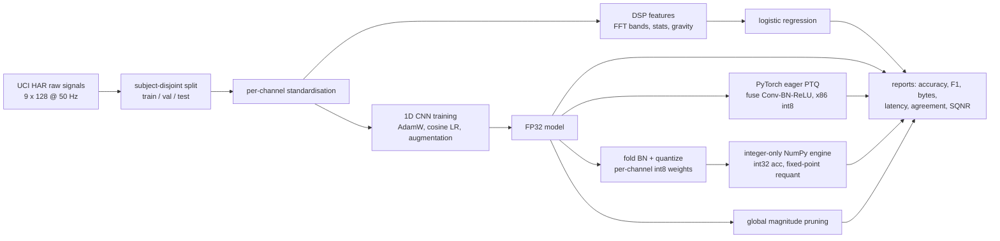

# haredge: activity recognition on inertial signals, compressed for embedded targets

[](https://github.com/Adversitas/har-edge-quant/actions/workflows/ci.yml)

A model that runs on a phone, a wearable or an automotive DSP has to fit a memory budget, run without
floating point in its inner loops and stay accurate after compression. This project takes one real
sensing task, **human activity recognition from 9-axis accelerometer and gyroscope signals**, and
works through it the way an embedded AI engineer would:

1. a **classical DSP baseline** (spectral and time-domain features + logistic regression), the bar
   any neural network has to clear;
2. a small **1D CNN** in PyTorch written to be quantization-friendly (Conv-BN-ReLU blocks, global
   average pooling);
3. **int8 post-training quantization** two ways: PyTorch's eager-mode PTQ (x86 backend), and an
   **integer-only inference engine written from scratch in NumPy** (BatchNorm folding, per-channel
   int8 weights, uint8 activations, int32 accumulators, fixed-point requantization with an int32
   multiplier and shift, as on a DSP or NPU);
4. **magnitude pruning** at 50, 75 and 90% sparsity;
5. measurements for all of it: accuracy and macro-F1 on held-out subjects, weight bytes, single-window
   CPU latency, int8/FP32 agreement, per-layer SQNR and sensitivity to the calibration-set size.

## Data

[UCI HAR](https://archive.ics.uci.edu/dataset/240/human+activity+recognition+using+smartphones)
(Anguita et al., ESANN 2013): 30 people wearing a smartphone on the waist, 6 activities (walking,
upstairs, downstairs, sitting, standing, laying). We use the **raw inertial signals** (body
acceleration, angular velocity and total acceleration on 3 axes, 50 Hz, 2.56 s windows of 128
samples), not the 561 pre-computed features. The authors' split is **subject-disjoint**: 21 people for
training (we hold out 4 of them for validation and model selection), 9 people never seen in training
for the test set (2,947 windows). The archive (60 MB) is downloaded by `haredge download` and is not
committed.

## Results

Test set: 2,947 windows from the 9 unseen subjects. CNN rows are mean ± std over 3 training seeds,
40 epochs each. Full table, calibration study and confusion matrix: [reports/results.md](reports/results.md),
raw numbers: [reports/results.json](reports/results.json).

| Model | Accuracy % | Macro-F1 % | Weights (bytes) | CPU latency, 1 window |
|---|---|---|---|---|
| DSP features (179) + logistic regression | **94.54** | **94.46** | 5,752 | n/a |
| 1D CNN, FP32 (PyTorch, 24,678 params) | 93.28 ± 0.58 | 93.30 ± 0.60 | 106,010 | 0.70 ms |
| 1D CNN, int8 PTQ (PyTorch x86) | 93.33 ± 0.62 | 93.35 ± 0.62 | 35,400 | 1.10 ms |
| 1D CNN, int8 integer-only engine (NumPy, p99.99 calibration) | 93.29 ± 0.58 | 93.31 ± 0.59 | **25,016** | n/a |
| 1D CNN, int8 integer-only engine (NumPy, max calibration) | 93.27 ± 0.43 | 93.29 ± 0.44 | 25,016 | n/a |
| 1D CNN, 50% magnitude pruning, no fine-tuning | 92.96 ± 0.39 | 92.94 ± 0.43 | n/a | n/a |
| 1D CNN, 75% magnitude pruning, no fine-tuning | 86.25 ± 1.15 | 86.30 ± 0.96 | n/a | n/a |
| 1D CNN, 90% magnitude pruning, no fine-tuning | 34.83 ± 6.75 | 23.05 ± 6.47 | n/a | n/a |

* **int8 costs nothing here.** The integer-only engine agrees with the FP32 network on **99.82 %** of
  test windows (PyTorch PTQ: 99.15 %) and macro-F1 moves by less than 0.05 points, for 4.2× fewer
  weight bytes than the serialized FP32 model. Per-layer SQNR stays above 34 dB (conv1 34.1, conv2 34.7, conv3 36.3, pooling 40.1,
  logits 42.9 dB for seed 0).
* **Calibration is cheap.** 16 calibration windows give the same macro-F1 as 1,024 (93.36 vs 93.30 %).
  Percentile (99.99) and max calibration give the same accuracy on this network.
* **The DSP baseline wins on accuracy** and its weights are 4× smaller than the int8 CNN's. The CNN's weak spot is
  the same as the baseline's (sitting vs standing, 94 sitting windows predicted as standing for seed 0),
  where the signal barely differs. On this task a CNN has to earn its place through other
  arguments (no hand-written features to maintain, transfer to new sensors), not raw accuracy.
* **PyTorch int8 is slower than FP32 at batch size 1 on x86** (1.10 vs 0.70 ms): for a 25k-parameter
  network, the quantize/dequantize and kernel dispatch overhead outweighs the int8 arithmetic. Int8
  pays off in memory and on hardware with int8 MAC units, not automatically in desktop CPU latency.
* **Pruning without fine-tuning breaks fast**: 50 % is almost free, 75 % loses 7 points, 90 % collapses.

The FP32 latency was measured with one thread, median of 300 runs, on an Intel laptop CPU (see
`platform` in results.json) while another job was using the GPU; treat it as relative, not absolute.

## Architecture



The integer engine ([src/haredge/int8.py](src/haredge/int8.py)) follows the gemmlowp / TFLite scheme:
for a layer with input scale `s_in`, per-channel weight scale `s_w[c]` and output scale `s_out`, the
real multiplier `M = s_in * s_w[c] / s_out` is stored as an int32 `M0` in [2^30, 2^31) plus a right
shift, and requantization is `(acc * M0 + 2^(30+shift)) >> (31+shift)` in 64-bit integer arithmetic.
Global average pooling is an int32 sum whose `1/T` is folded into the multiplier. Tests check that the
engine never produces a float tensor before the final logits.

## How to run

```bash
pip install torch --index-url https://download.pytorch.org/whl/cpu   # or a CUDA build
pip install -e ".[dev]"
haredge download                  # UCI HAR -> data/uci_har.npz
haredge run --seeds 0 1 2         # ~10 min on a laptop CPU, writes reports/
pytest -q && ruff check . && ruff format --check .
haredge run --synthetic --seeds 0 --epochs 2   # 30 s smoke run, no download (what CI runs)
```

## Project layout

```
src/haredge/
  data.py        download, parsing, subject-disjoint split, standardisation, synthetic signals
  features.py    DSP feature extraction (FFT band energies, spectral entropy, gravity direction)
  model.py       HARNet 1D CNN, training loop with augmentation and best-epoch selection
  compress.py    PyTorch PTQ, magnitude pruning, latency and size measurement
  int8.py        BN folding, quantization, integer-only inference engine, SQNR
  experiment.py  the full study and the markdown report
tests/           fixed-point arithmetic, BN folding vs PyTorch, int8 vs float, pipeline smoke test
```

## Limitations

* One dataset, one network size. A real product would sweep width and depth against a memory and
  cycle budget on the target, not on a laptop.
* The NumPy engine shows the arithmetic, it is not fast: its latency is not reported because
  Python loops and `einsum` say nothing about a DSP. The C/assembly kernel is the next step.
* Pruning is unstructured and without fine-tuning, so it saves no time on dense hardware; structured
  (channel) pruning with retraining is the useful variant for an accelerator.
* No quantization-aware training: it was not needed here (PTQ loses nothing), but it would be for
  smaller widths or 4-bit weights.
* Windows come from 30 people of similar age in a lab protocol; accuracy on the street, with the phone
  in a pocket or a bag, would be lower.

## En bref (FR)

Reconnaissance d'activité (marche, escaliers, assis, debout, allongé) à partir des signaux bruts
accéléromètre + gyroscope du jeu de données UCI HAR, avec un test sur des personnes jamais vues à
l'entraînement. On compare une base DSP classique (énergies spectrales FFT + régression logistique)
à un CNN 1D PyTorch, puis on compresse le CNN : quantification int8 post-entraînement avec PyTorch,
**moteur d'inférence entièrement entier écrit en NumPy** (repliement BatchNorm, poids int8 par canal,
accumulateurs int32, requantification en virgule fixe comme sur un DSP) et élagage. Résultats mesurés :
l'int8 garde 99,8 % des prédictions du modèle FP32 pour 4,2× moins de mémoire de poids ; la base DSP
reste la plus précise (94,5 % de F1 macro contre 93,3 %) ; l'int8 PyTorch est plus lent que le FP32 sur
CPU x86 à batch 1 pour un réseau aussi petit.

## License

MIT, see [LICENSE](LICENSE). UCI HAR is distributed by the UCI Machine Learning Repository under
CC BY 4.0; cite Anguita et al. (2013) when using it.
